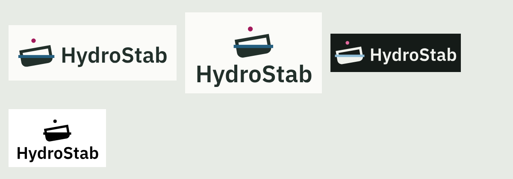

# HydroStab logo — usage guide

## The idea
**Righting Hull.** A ship's midship section heeled 10°. The waterline stays level, the underwater body is solid
(the shifted buoyancy that brings the ship back upright) and the dot is the **metacentre M**, on the ship's own
centreline. One picture of intact stability.

## Versions (all in `docs/brand/logo-a2/`)

| Use | File |
|---|---|
| Symbol, colour (32 px and up) | `a2-symbol-colour.svg` |
| Symbol, small sizes (16–24 px: thicker lines, bigger dot) | `a2-symbol-small-colour.svg`, `a2-symbol-small-black.svg` |
| Symbol, one colour / on dark | `a2-symbol-black.svg`, `a2-symbol-reversed.svg` |
| Name beside the symbol (main lockup) | `a2-lockup-horizontal-colour.svg` (`-black`, `-reversed`) |
| Name under the symbol (square spaces, covers) | `a2-lockup-stacked-colour.svg` (`-black`, `-reversed`) |
| App icons (chart-paper / dark tile) | `a2-appicon.svg`, `a2-appicon-dark.svg` |

In the app the symbol is the component `src/ui/LogoMark.tsx` (colours follow the light / dark theme); the browser
tab icon is `public/icon.svg` (switches colours with the computer's dark mode); install icons come from
`scripts/make-icons.cjs`; reports use `src/report/logoPng.ts`.

## Colours

| Name | HEX | RGB | CMYK (approx.) | Used for |
|---|---|---|---|---|
| Ink | `#22302B` | 34, 48, 43 | C29 M0 Y10 K81 | hull, underwater body, the name |
| Chart blue | `#245F80` | 36, 95, 128 | C72 M26 Y0 K50 | waterline |
| Chart magenta | `#A3195B` | 163, 25, 91 | C0 M85 Y44 K36 | metacentre dot |
| Chart paper | `#E7EBE5` | 231, 235, 229 | C2 M0 Y3 K8 | app-icon background |
| Reversed ink | `#F1F3EE` | 241, 243, 238 | C1 M0 Y2 K5 | hull and name on dark |
| Reversed blue | `#8EBCD6` | 142, 188, 214 | C34 M12 Y0 K16 | waterline on dark |
| Reversed magenta | `#E36A9F` | 227, 106, 159 | C0 M53 Y30 K11 | metacentre on dark |

One-colour use: all black (or all ink) on light, all `#F1F3EE` on dark. Never more than these three colours in the mark.

## Clear space and minimum size
- **Unit x** = the diameter of the metacentre dot (24 units in the 256-unit symbol).
- **Clear space:** at least **1 x** on every side of the symbol or lockup — no text, edges or other marks inside it.
- **Minimum size:** symbol 32 px / 8 mm (below that use the small version, down to 16 px); horizontal lockup
  120 px / 30 mm wide; stacked lockup 80 px / 20 mm wide.

## Backgrounds
Chart paper `#E7EBE5`, white, or the app's light surfaces → colour version. Dark (`#151B18` and similar) → reversed
version. Photos or busy backgrounds → place the symbol on a chart-paper or dark tile.

## Don't
- Don't rotate the mark to "straighten" the ship, change the 10° heel, or tilt the waterline — the level waterline is the idea.
- Don't move the metacentre dot, change its colour to something other than magenta (or the one-colour version), or drop it above 24 px.
- Don't recolour parts, add gradients, shadows or outlines, or stretch the mark.
- Don't retype the name in another font or rearrange the lockup; use the files.
- Don't put the regular symbol below 32 px — use the small version.

## Type
The name is **IBM Plex Sans SemiBold**, converted to outlines in the lockup files (SIL Open Font Licence — free
for logo use). The app uses IBM Plex Sans / Mono.

## Changing the logo
Shapes come from `logo-a2/build_a2.py` (proportions, heel, line weights) — run it, then `node scripts/make-icons.cjs`,
regenerate `src/ui/LogoMark.tsx` from `build_a2.py --json`, and the report PNG. No trademark search has been done;
do one before formal registration.
